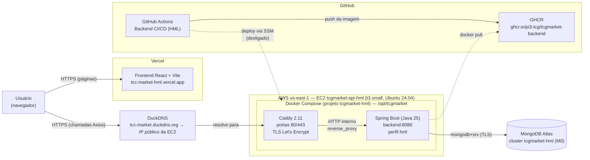
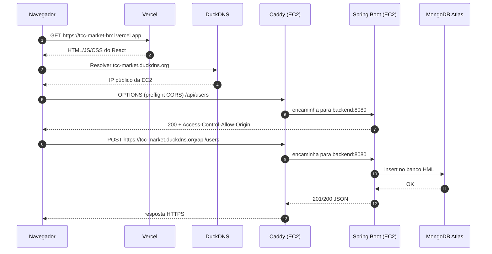
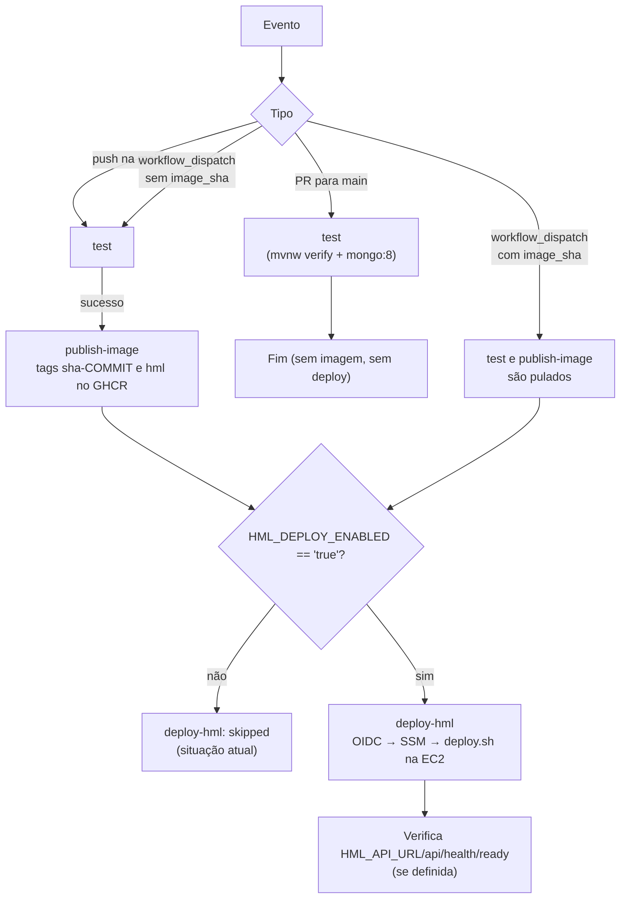
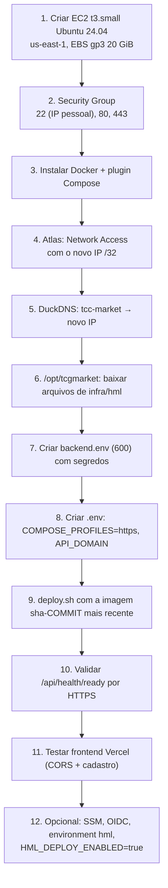

# Ambiente de Homologação (HML) — TCG Market

Documento de referência da infraestrutura de homologação do TCG Market: arquitetura, configuração, deploy, operação, diagnóstico, segurança e custos.

Público-alvo: qualquer integrante do grupo que precise entender, operar ou reconstruir o ambiente sem depender de quem fez a configuração inicial.

> **Documento complementar:** [`infra/hml/README.md`](../../infra/hml/README.md) contém o passo a passo detalhado de preparação (IAM, OIDC, SSM, environment do GitHub, `backend.env`). Este documento descreve o ambiente **como ele está hoje** e aponta onde aquele README ficou desatualizado (ver [seção 19](#19-pendências-divergências-e-melhorias-futuras)).

## Legenda de confiabilidade

Cada informação deste documento tem uma origem. Para não misturar o que o código garante com o que foi configurado à mão:

| Marcador | Significado |
| --- | --- |
| **[Código]** | Confirmado diretamente nos arquivos do repositório (workflow, Compose, scripts, Spring, frontend). |
| **[Externo]** | Configuração feita manualmente em um painel (AWS, Atlas, Vercel, DuckDNS, GitHub) e informada pela equipe. Não é verificável pelo repositório. |
| **[A validar]** | Informação incompleta, divergente ou ainda sem evidência. Precisa ser conferida manualmente. |

---

## Sumário

1. [Visão geral](#1-visão-geral)
2. [Arquitetura](#2-arquitetura)
3. [Tecnologias e serviços](#3-tecnologias-e-serviços)
4. [Endereços e ambientes](#4-endereços-e-ambientes)
5. [Infraestrutura AWS EC2](#5-infraestrutura-aws-ec2)
6. [Docker e containers](#6-docker-e-containers)
7. [Caddy, DNS e HTTPS](#7-caddy-dns-e-https)
8. [MongoDB Atlas](#8-mongodb-atlas)
9. [Frontend e Vercel](#9-frontend-e-vercel)
10. [CORS](#10-cors)
11. [Variáveis de ambiente](#11-variáveis-de-ambiente)
12. [CI/CD e GHCR](#12-cicd-e-ghcr)
13. [Procedimento de deploy](#13-procedimento-de-deploy)
14. [Procedimento de rollback](#14-procedimento-de-rollback)
15. [Monitoramento e logs](#15-monitoramento-e-logs)
16. [Testes e evidências](#16-testes-e-evidências)
17. [Troubleshooting](#17-troubleshooting)
18. [Segurança](#18-segurança)
19. [Pendências, divergências e melhorias futuras](#19-pendências-divergências-e-melhorias-futuras)
20. [Custos e limitações](#20-custos-e-limitações)
21. [Reconstrução do ambiente do zero](#21-reconstrução-do-ambiente-do-zero)

---

## 1. Visão geral

O ambiente de HML é uma cópia funcional do sistema, publicada na internet, usada para validar funcionalidades antes de considerá-las prontas. Ele é composto por três partes independentes:

- **Frontend** (React + Vite) hospedado na **Vercel**.
- **Backend** (Java + Spring Boot) rodando em **Docker** numa instância **AWS EC2**, atrás do proxy reverso **Caddy**, que fornece HTTPS.
- **Banco de dados** no **MongoDB Atlas** (serviço gerenciado; não existe MongoDB na EC2).

O backend é compilado e testado apenas no **GitHub Actions**. A imagem Docker resultante é publicada no **GitHub Container Registry (GHCR)** e a EC2 só baixa a imagem pronta.

Resumo do que é automático e do que é manual:

| Atividade | Situação |
| --- | --- |
| Testes do backend a cada PR / push na `main` | Automático **[Código]** |
| Build e publicação da imagem no GHCR a cada push na `main` | Automático **[Código]** |
| Deploy da imagem na EC2 | Automação existe no código, mas **está desligada** enquanto `HML_DEPLOY_ENABLED` não for `true` **[Código]**. O deploy inicial foi feito manualmente **[Externo]** |
| Deploy do frontend | Feito pela Vercel **[Externo]** (não há configuração da Vercel no repositório) |
| Certificado TLS | Automático pelo Caddy (Let's Encrypt) **[Código]** |
| DNS (DuckDNS), Security Group, Atlas Network Access, variáveis da Vercel | Manual **[Externo]** |

---

## 2. Arquitetura

### 2.1 Diagrama de componentes



### 2.2 Fluxo de uma requisição

1. O usuário acessa o frontend em `https://tcc-market-hml.vercel.app`. A Vercel entrega os arquivos estáticos (HTML, JS, CSS).
2. O React, via Axios, envia requisições HTTPS para `https://tcc-market.duckdns.org/api/...`. **[Código]** (`frontend/src/services/api.ts`)
3. O navegador resolve `tcc-market.duckdns.org` pelo DuckDNS, que aponta para o IP público da EC2. **[Externo]**
4. O Caddy recebe a conexão nas portas 80/443, termina o TLS e encaminha a requisição para `backend:8080` pela rede interna do Docker. **[Código]** (`infra/hml/Caddyfile`)
5. O Spring Boot processa a requisição dentro do container `tcgmarket-backend` (CORS, autenticação JWT, regras de negócio). **[Código]**
6. O backend lê/grava no MongoDB Atlas usando a URI definida em `MONGODB_URI`. **[Código]** + **[Externo]**
7. A resposta volta pelo mesmo caminho (Spring → Caddy → navegador) e o React atualiza a tela.



---

## 3. Tecnologias e serviços

| Componente | Tecnologia | Hospedagem | Origem da informação |
| --- | --- | --- | --- |
| Frontend | React 19 + Vite 8 + TypeScript, Axios, TanStack Router | Vercel | **[Código]** `frontend/package.json` + **[Externo]** |
| Backend | Java 25 + Spring Boot 4.1.1 (WebMVC, Security, Data MongoDB, Validation), JWT com `nimbus-jose-jwt` | AWS EC2 | **[Código]** `backend/pom.xml` |
| Containerização | Docker + Docker Compose | AWS EC2 | **[Código]** `infra/hml/compose.yaml` |
| Proxy reverso | Caddy `2.11-alpine` | AWS EC2 | **[Código]** |
| HTTPS | TLS automático pelo Caddy (Let's Encrypt) | AWS EC2 | **[Código]** `infra/hml/Caddyfile` |
| Banco de dados | MongoDB Atlas, cluster `tcgmarket-hml`, plano M0 | MongoDB Atlas | **[Externo]** |
| Registro de imagens | GitHub Container Registry | GHCR | **[Código]** |
| CI/CD | GitHub Actions | GitHub | **[Código]** `.github/workflows/backend-ci-cd.yml` |
| DNS | DuckDNS | DuckDNS | **[Externo]** |
| Deploy remoto (previsto) | AWS Systems Manager (SSM Run Command) + OIDC | AWS | **[Código]**; ativação **[A validar]** |

---

## 4. Endereços e ambientes

| Item | Endereço |
| --- | --- |
| Frontend HML | https://tcc-market-hml.vercel.app |
| Backend HML (base da API) | https://tcc-market.duckdns.org |
| Liveness | https://tcc-market.duckdns.org/api/health |
| Readiness | https://tcc-market.duckdns.org/api/health/ready |
| Imagem do backend | `ghcr.io/pi3-tcg/tcgmarket-backend` |
| Diretório da aplicação na EC2 | `/opt/tcgmarket` |

Ambientes do projeto:

| Ambiente | Frontend | Backend | Banco |
| --- | --- | --- | --- |
| Desenvolvimento (local) | `npm run dev` em `http://localhost:5173` | Spring local, perfil `dev` | MongoDB local via `backend/docker-compose.yml` |
| Testes (CI) | — | `mvnw verify` no runner | Container `mongo:8` descartável no job |
| **HML** | Vercel | EC2 + Docker, perfil `hml` | MongoDB Atlas `tcgmarket-hml` |
| Produção | Não existe ainda | `application-prod.yaml` existe, mas está vazio **[Código]** | — |

---

## 5. Infraestrutura AWS EC2

### 5.1 Dados da instância **[Externo]**

| Campo | Valor |
| --- | --- |
| Nome | `tcgmarket-api-hml` |
| Instance ID | `i-04ff5e4fe9e88b157` |
| Região | `us-east-1` (Norte da Virgínia) |
| Tipo | `t3.small` (2 vCPU, 2 GiB de RAM) |
| Sistema operacional | Ubuntu 24.04 LTS |
| IP público observado na implantação | `100.31.57.219` (**não é fixo**, ver 5.6) |
| Diretório da aplicação | `/opt/tcgmarket` |

### 5.2 Como localizar a instância no Console da AWS

1. Acesse o Console da AWS e confirme que a região selecionada (canto superior direito) é **N. Virginia — us-east-1**. Instâncias de outra região não aparecem na lista.
2. Vá em **EC2 → Instances**.
3. Filtre por `tcgmarket-api-hml` ou pelo ID `i-04ff5e4fe9e88b157`.
4. Na aba **Details** estão o IP público atual (*Public IPv4 address*), o Security Group, a IAM role e o estado.

### 5.3 Status da instância

- **Instance state**: precisa estar `Running`.
- **Status check**: a coluna mostra `2/2 checks passed` (ou `3/3`, conforme o console) quando a máquina e o hardware subjacente estão saudáveis. Falha em *System status check* indica problema da AWS; falha em *Instance status check* indica problema no sistema operacional (disco cheio, kernel, rede).
- Pela AWS CLI (se configurada):

```bash
aws ec2 describe-instance-status --region us-east-1 \
  --instance-ids i-04ff5e4fe9e88b157 --include-all-instances
```

### 5.4 Conectar via SSH

O usuário padrão das AMIs oficiais do Ubuntu é `ubuntu`. A chave `.pem` é a do key pair escolhido na criação da instância **[A validar: nome do key pair e quem guarda a chave]**.

```bash
chmod 400 ~/.ssh/<chave-hml>.pem
ssh -i ~/.ssh/<chave-hml>.pem ubuntu@<IP-PUBLICO-ATUAL>
```

Use sempre o IP atual mostrado no console (ou `tcc-market.duckdns.org`, se o DNS estiver atualizado).

Alternativa sem SSH: **Systems Manager → Session Manager**, se a instância tiver a role `AmazonSSMManagedInstanceCore` (preparação descrita em `infra/hml/README.md`, seção 3.1). **[A validar: se a role foi anexada]**

### 5.5 Security Group

O Security Group é o firewall da instância: define quais portas aceitam conexões de entrada e de onde.

Regras recomendadas pelo projeto (`infra/hml/README.md`, seção 3.4) **[A validar: conferir as regras reais no console]**:

| Porta | Origem | Motivo |
| --- | --- | --- |
| 22/TCP (SSH) | Apenas o IP pessoal de quem administra (`x.x.x.x/32`) | SSH dá acesso de administrador ao servidor. Aberta para `0.0.0.0/0`, recebe tentativas automáticas de força bruta o tempo todo. Se o Session Manager estiver ativo, a regra pode até ser removida. |
| 80/TCP (HTTP) | `0.0.0.0/0` | Necessária para a Let's Encrypt validar o domínio (desafio HTTP-01) e para o Caddy redirecionar HTTP → HTTPS. |
| 443/TCP (HTTPS) | `0.0.0.0/0` | Porta usada pelo navegador para acessar a API. Precisa ser pública porque os usuários do frontend estão em qualquer lugar. |
| 8080/TCP | **Nenhuma regra** | O backend não deve ser acessado diretamente: isso pularia o HTTPS e os headers do Caddy. O Compose já publica a 8080 apenas em `127.0.0.1` **[Código]**, então mesmo com regra aberta ela não responderia externamente — mas não crie a regra. |
| 27017/TCP | **Nenhuma regra** | Não há MongoDB na EC2. |

> Atenção: quando o IP pessoal de quem administra muda (internet residencial costuma mudar), a regra da porta 22 precisa ser atualizada, senão o SSH dá *timeout*.

### 5.6 IP público dinâmico (não é Elastic IP)

O IP `100.31.57.219` foi o observado durante a implantação. **Ele não é um Elastic IP** **[Externo]**, então:

- **Reboot** (reiniciar) mantém o IP.
- **Stop + Start** (parar e iniciar) **troca o IP**.

Consequências de uma troca de IP:

| Onde | Efeito | Correção |
| --- | --- | --- |
| DuckDNS | `tcc-market.duckdns.org` continua apontando para o IP antigo; a API fica inacessível e o frontend mostra erro de rede. | Atualizar o IP no painel do DuckDNS (ver [7.2](#72-dns-com-duckdns)). |
| MongoDB Atlas (Network Access) | O Atlas recusa a conexão do novo IP; `/api/health/ready` responde `503 DOWN`. | Adicionar o novo IP `/32` e remover o antigo. |
| Security Group (porta 22) | Não muda (a regra é sobre o IP de **quem acessa**, não da EC2). | — |
| Certificado TLS | Caddy renova normalmente depois que o DNS estiver correto. | — |

O procedimento completo está em [17.8](#178-o-ip-público-da-ec2-mudou).

Um Elastic IP resolveria o problema, mas tem custo e deve ser decidido pelo grupo (ver [seção 20](#20-custos-e-limitações)).

### 5.7 Métricas no CloudWatch

EC2 → instância → aba **Monitoring** (ou **CloudWatch → Metrics → EC2 → Per-Instance Metrics**). Métricas disponíveis sem instalar nada:

- `CPUUtilization`
- `CPUCreditBalance` / `CPUCreditUsage` (importantes em instâncias T3, ver [seção 20](#20-custos-e-limitações))
- `NetworkIn` / `NetworkOut`
- `StatusCheckFailed`

**Memória e uso de disco não aparecem no CloudWatch por padrão**: exigem o CloudWatch Agent, que não foi instalado. Para esses dados use os comandos da [seção 15](#15-monitoramento-e-logs) diretamente na EC2.

### 5.8 Arquivos na EC2 **[Código]** (estrutura esperada pelos scripts)

```text
/opt/tcgmarket/
├── compose.yaml         # cópia de infra/hml/compose.yaml
├── Caddyfile            # cópia de infra/hml/Caddyfile
├── deploy.sh            # cópia de infra/hml/deploy.sh
├── healthcheck.sh       # cópia de infra/hml/healthcheck.sh
├── rollback.sh          # cópia de infra/hml/rollback.sh
├── .env                 # configuração do Compose (sem segredos): BACKEND_IMAGE, COMPOSE_PROFILES, API_DOMAIN
├── backend.env          # SEGREDOS da aplicação (permissão 600, dono root)
└── state/
    ├── current_image    # imagem em execução (gravado pelo deploy.sh)
    ├── previous_image   # imagem anterior (usado no rollback)
    └── deploy.lock      # trava contra deploys simultâneos
```

> Os arquivos `state/*` só existem se o deploy tiver sido feito pelo `deploy.sh`. Se o deploy inicial foi feito apenas com `docker compose`, eles podem não existir. **[A validar]** com `sudo cat /opt/tcgmarket/state/current_image`.

---

## 6. Docker e containers

### 6.1 Empacotamento do backend **[Código]** (`backend/Dockerfile`)

Build *multi-stage*:

1. **Estágio `build`** (`eclipse-temurin:25-jdk-noble`): baixa as dependências com o Maven Wrapper, compila com `-DskipTests` (os testes já rodaram no job de CI) e extrai o JAR em camadas (`jarmode=tools ... --layers`). Camadas separadas fazem com que um deploy que só muda código baixe pouca coisa.
2. **Estágio `runtime`** (`eclipse-temurin:25-jre-noble`): só a JRE, `curl` (para o healthcheck) e a aplicação. Roda como usuário não-root `app` (uid 10001), expõe a 8080 e inicia com `JarLauncher`.

O `backend/.dockerignore` envia ao build somente `pom.xml`, `mvnw`, `.mvn/` e `src/`, e exclui qualquer `.env`, então segredos locais nunca entram na imagem.

### 6.2 Publicação no GHCR **[Código]**

O job `publish-image` do workflow faz build para `linux/amd64` e publica:

| Tag | Uso |
| --- | --- |
| `ghcr.io/pi3-tcg/tcgmarket-backend:sha-<commit com 40 caracteres>` | Imutável. **É a única forma aceita pelo `deploy.sh`.** |
| `ghcr.io/pi3-tcg/tcgmarket-backend:hml` | Ponteiro para a última imagem publicada. Conveniência; nunca usado no deploy. |

Imagem utilizada na validação inicial **[Externo]**:

```text
ghcr.io/pi3-tcg/tcgmarket-backend:sha-fdbe5d3813e8f2d8e80d694936848225962a9bdd
```

Ela corresponde ao commit `fdbe5d3` (merge do PR #134, gerenciamento de perfil). É uma **referência histórica** da primeira implantação: commits posteriores na `main` que alteraram `backend/**` geram imagens mais novas. Para saber o que está rodando agora, consulte a EC2 ([15.1](#151-o-que-está-rodando)).

### 6.3 Como a EC2 obtém a imagem

A EC2 executa `docker pull` da tag `sha-...` no GHCR. Para funcionar sem credencial, o pacote `tcgmarket-backend` precisa estar **público** na organização `PI3-TCG`; caso contrário, é necessário `docker login ghcr.io` na EC2 com um token `read:packages`. **[A validar: visibilidade atual do pacote]**

### 6.4 Docker Compose **[Código]** (`infra/hml/compose.yaml`)

Projeto `tcgmarket-hml` com dois serviços:

| Serviço | Container | Detalhes |
| --- | --- | --- |
| `backend` | `tcgmarket-backend` | Imagem em `${BACKEND_IMAGE}`; variáveis de `backend.env`; `SPRING_PROFILES_ACTIVE=hml`; porta `127.0.0.1:8080:8080`; limites `mem_limit: 900m`, `cpus: 1.5`, `pids_limit: 512`; sistema de arquivos `read_only` com `/tmp` em memória (64 MB); `cap_drop: ALL`; `no-new-privileges`; healthcheck em `/api/health/ready`. |
| `caddy` | `tcgmarket-caddy` | Só sobe com o **perfil `https`**; portas `80` e `443` públicas; `mem_limit: 128m`; só a capability `NET_BIND_SERVICE`; volumes `caddy_data` e `caddy_config`. |

**Variável `BACKEND_IMAGE`**: fica em `/opt/tcgmarket/.env` e é **mantida pelo `deploy.sh`** (ele reescreve a linha a cada deploy). Se estiver ausente, o Compose falha com a mensagem `BACKEND_IMAGE precisa apontar para uma tag sha-<commit>`.

**Perfil `https`**: o Caddy só é considerado pelo Compose quando o perfil está ativo, seja por `COMPOSE_PROFILES=https` no `.env`, seja por `--profile https` na linha de comando. Por isso `docker compose --profile https ps` mostra os dois serviços mesmo que o `.env` não tenha o perfil. **[A validar: se `COMPOSE_PROFILES=https` e `API_DOMAIN=tcc-market.duckdns.org` estão no `.env` da EC2]** — o `deploy.sh` exige `API_DOMAIN` preenchido quando o perfil está ativo.

**Dependência Caddy → backend**: `depends_on: backend: condition: service_healthy`. O Caddy só é iniciado depois que o healthcheck do backend passa, ou seja, depois que o Spring subiu **e** conseguiu fazer `ping` no Atlas.

**Healthcheck do backend**: `curl` em `http://127.0.0.1:8080/api/health/ready` a cada 15 s, timeout de 5 s, 3 tentativas, com 90 s de tolerância inicial (`start_period`) para a JVM subir.

**Reinício**: ambos usam `restart: unless-stopped`. O Docker reinicia o container se ele cair e também quando a EC2 reinicia, desde que o serviço Docker esteja habilitado no boot **[A validar: `systemctl is-enabled docker`]**. Containers parados manualmente com `docker compose stop` não voltam sozinhos.

**Memória da JVM**: `JAVA_TOOL_OPTIONS=-XX:MaxRAMPercentage=65 -XX:+ExitOnOutOfMemoryError` → heap de até ~585 MiB dentro do limite de 900 MiB. Em caso de falta de memória, a JVM encerra e o Docker reinicia o container.

**Logs**: driver `json-file` com rotação (3 arquivos de 10 MB por container), para não encher o disco.

**Volumes do Caddy**: `caddy_data` guarda os certificados TLS e a conta ACME; `caddy_config` guarda a configuração ativa. Por serem volumes nomeados, sobrevivem à recriação do container. **Não apague esses volumes** (`docker compose down -v` apagaria): o Caddy teria que reemitir o certificado, e a Let's Encrypt limita a quantidade de emissões por domínio por semana.

### 6.5 Comandos operacionais

Todos executados na EC2:

```bash
cd /opt/tcgmarket

# Estado dos containers (inclui o Caddy, mesmo sem COMPOSE_PROFILES no .env)
sudo docker compose --profile https ps

# Últimas 100 linhas de log
sudo docker compose logs --tail=100 backend
sudo docker compose --profile https logs --tail=100 caddy

# Baixar e subir a imagem definida em BACKEND_IMAGE (ver ressalva abaixo)
sudo docker compose pull backend
sudo docker compose up -d backend
```

> **Diferença importante:** `docker compose pull` + `up -d` apenas recriam o container com a imagem que **já está** em `BACKEND_IMAGE`. Eles **não** trocam de versão, **não** esperam a saúde, **não** fazem rollback automático e **não** atualizam `state/current_image` / `state/previous_image`. Para trocar de versão, use sempre o `deploy.sh` ([seção 13](#13-procedimento-de-deploy)). Reserve os comandos manuais para diagnóstico ou para reaplicar configuração.

---

## 7. Caddy, DNS e HTTPS

### 7.1 Papel do Caddy **[Código]** (`infra/hml/Caddyfile`)

```caddy
{$API_DOMAIN} {
	encode zstd gzip
	reverse_proxy backend:8080
	header {
		Strict-Transport-Security "max-age=31536000"
		X-Content-Type-Options "nosniff"
		-Server
	}
	log {
		output stdout
		format json
	}
}
```

- **Site**: o domínio vem da variável `API_DOMAIN` (em HML: `tcc-market.duckdns.org` **[Externo]**).
- **Proxy reverso**: encaminha tudo para `backend:8080` (nome do serviço na rede interna do Compose).
- **Compressão**: zstd/gzip nas respostas.
- **Headers de segurança**:
  - `Strict-Transport-Security: max-age=31536000` (HSTS por 1 ano: o navegador passa a usar só HTTPS para esse domínio);
  - `X-Content-Type-Options: nosniff` (impede o navegador de "adivinhar" o tipo do conteúdo);
  - remoção do header `Server` (não revela o software do servidor).
- **Logs** de acesso em JSON na saída padrão (visíveis com `docker compose logs caddy`).
- O Spring, no perfil `hml`, usa `server.forward-headers-strategy: framework` **[Código]**, então entende os headers `X-Forwarded-*` enviados pelo Caddy (protocolo HTTPS original, IP do cliente).

### 7.2 DNS com DuckDNS **[Externo]**

- Domínio: `tcc-market.duckdns.org`.
- Configurado no painel do [DuckDNS](https://www.duckdns.org), na conta de quem criou o subdomínio **[A validar: qual conta/integrante administra o DuckDNS]**.
- O registro aponta para o IP público atual da EC2. A atualização é **manual** (não há cliente de atualização automática configurado no repositório) **[A validar: se existe cron do DuckDNS na EC2]**.

### 7.3 Certificados TLS

- O Caddy emite o certificado automaticamente na primeira subida, desde que o domínio já resolva para a EC2 e as portas 80/443 estejam abertas.
- A renovação também é automática (o Caddy renova antes do vencimento, sem intervenção).
- Os certificados ficam no volume `caddy_data` e sobrevivem a deploys e reinícios.

### 7.4 Validação

```bash
# 1) O DNS resolve para o IP atual da EC2?
getent ahostsv4 tcc-market.duckdns.org

# 2) A API responde por HTTPS com certificado válido?
curl -i --max-time 20 \
  https://tcc-market.duckdns.org/api/health/ready
```

Resultado obtido na validação real **[Externo]**:

```http
HTTP/2 200
```

```json
{
  "status": "UP",
  "message": "API pronta para receber tráfego."
}
```

Liveness:

```bash
curl -i --max-time 20 https://tcc-market.duckdns.org/api/health
```

```json
{
  "status": "On-The-Line",
  "message": "Todo grande projeto começa com um primeiro endpoint. Esse é o nosso."
}
```

Diferença entre os dois endpoints **[Código]** (`HealthController.java`):

| Endpoint | Tipo | O que verifica | Respostas |
| --- | --- | --- | --- |
| `GET /api/health` | Liveness | Só que o Spring está respondendo. Não acessa o banco. | Sempre `200` com a mensagem fixa acima. |
| `GET /api/health/ready` | Readiness | Executa `ping` no MongoDB. | `200 {"status":"UP"}` ou `503 {"status":"DOWN","message":"Banco de dados indisponível."}` (sem detalhes do erro, porque é público). |

Ambos são públicos (não exigem JWT) **[Código]** (`SecurityConfig.java`). O readiness é o que o healthcheck do Docker, o `healthcheck.sh` e o pipeline usam.

### 7.5 Investigando problemas de DNS, certificado e conexão

| Sintoma | Verificação | Causa provável |
| --- | --- | --- |
| `curl: (6) Could not resolve host` | `getent ahostsv4 tcc-market.duckdns.org` não retorna nada | Problema no DuckDNS ou no DNS local. |
| DNS retorna IP diferente do console da EC2 | Comparar com *Public IPv4 address* | EC2 foi parada/iniciada. Atualizar o DuckDNS. |
| `Connection timed out` | DNS correto | Security Group sem 80/443, instância parada, ou Caddy fora do ar. |
| `Connection refused` | DNS correto | Nada escutando na 443: Caddy parado ou perfil `https` não ativo. |
| Erro de certificado (`SSL certificate problem`, aviso no navegador) | `docker compose logs caddy` procurando `acme`/`error` | Certificado não emitido: DNS apontava para outro IP no momento da emissão, porta 80 fechada, ou limite de emissões da Let's Encrypt. |
| `502 Bad Gateway` | `docker compose ps` | Caddy está no ar, mas o backend está parado ou reiniciando. |

Para checar o certificado:

```bash
curl -vI https://tcc-market.duckdns.org/api/health 2>&1 | grep -Ei 'subject|issuer|expire'
```

---

## 8. MongoDB Atlas

### 8.1 Visão geral

- O MongoDB é o banco de dados obrigatório do projeto.
- Em HML, o banco é o **MongoDB Atlas**, cluster **`tcgmarket-hml`**, plano **M0** (gratuito, compartilhado) **[Externo]**.
- **Não existe MongoDB na EC2** **[Código]** — o comentário no topo do `compose.yaml` proíbe adicioná-lo.

### 8.2 Conexão do Spring Boot **[Código]**

- `application.yaml`: `spring.mongodb.uri: ${MONGODB_URI}`.
- A URI vem do arquivo `/opt/tcgmarket/backend.env` na EC2, injetado no container via `env_file`.
- Formato esperado (exemplo **sem valores reais**):

```text
mongodb+srv://<usuario>:<senha>@<host-do-cluster>/<nome-do-banco>?retryWrites=true&w=majority
```

- URIs `mongodb+srv://` usam TLS automaticamente.
- `auto-index-creation: true`: os índices declarados nas entidades são criados na inicialização.

> **Nunca** coloque a URI real, usuário ou senha em documentação, issues, PRs, chats ou commits. **[A validar]**: nome do banco usado na URI e nome do usuário de banco de HML (registrar só os nomes, nunca a senha).

### 8.3 Network Access

- Em **Atlas → Security → Network Access**, deve estar liberado **apenas** o IP público atual da EC2 com máscara `/32` **[Externo]**.
- Evite `0.0.0.0/0`: deixaria o banco aceitando conexões de qualquer lugar, protegido só pela senha.
- Ao trocar o IP da EC2, atualize essa lista (ver [17.8](#178-o-ip-público-da-ec2-mudou)).

### 8.4 Database Access

Recomendação do projeto (`infra/hml/README.md`, seção 6): usuário exclusivo de HML com papel `readWrite` apenas no banco de HML, nunca o usuário administrador. **[A validar: papel do usuário criado]**

### 8.5 Data Explorer

1. Atlas → projeto do TCG Market → **Database / Clusters** → cluster `tcgmarket-hml` → **Browse Collections** (Data Explorer).
2. Selecione o banco de HML e a coleção desejada.
3. Use o campo **Filter** para consultar, por exemplo:

```json
{ "username": "<username-de-teste>" }
```

### 8.6 Verificar se um cadastro foi persistido

1. Cadastre um usuário pelo frontend HML e anote o `id` retornado (DevTools → Network → requisição `POST /api/users` → Response).
2. No Data Explorer, abra a coleção `users` e filtre pelo `_id`:

```json
{ "_id": { "$oid": "<id-retornado>" } }
```

3. Confira `username`, `role` e `registrationDate`. O documento também contém o hash da senha: **não copie nem exponha esse conteúdo**.

O nome da coleção vem de `@Document(collection = "users")` em `backend/src/main/java/com/pitcc/model/User.java` **[Código]**.

### 8.7 Cuidados com dados

- HML está na internet: trate os dados como reais. Use contas de teste com e-mails fictícios sempre que possível.
- Não exporte coleções com dados pessoais para máquinas pessoais nem compartilhe prints com e-mails/nomes.
- O M0 não tem backup automático gerenciado como os planos pagos; não guarde em HML nada que não possa ser perdido.

---

## 9. Frontend e Vercel

### 9.1 Deploy do frontend **[Externo]**

- URL: https://tcc-market-hml.vercel.app
- O repositório não contém `vercel.json` nem workflow para o frontend **[Código]**: build e deploy são feitos pela integração da Vercel com o GitHub.
- Configuração esperada do projeto na Vercel **[A validar no painel]**: *Root Directory* = `frontend`, *Framework* = Vite, *Build Command* = `npm run build` (`tsc -b && vite build`), *Output Directory* = `dist`, branch de produção do projeto Vercel.

### 9.2 Variável `VITE_API_URL`

Valor configurado em HML **[Externo]**:

```env
VITE_API_URL=https://tcc-market.duckdns.org
```

Como é usada **[Código]** (`frontend/src/services/api.ts`):

```ts
export const api = axios.create({
  baseURL: import.meta.env.VITE_API_URL,
})
```

E os serviços chamam caminhos que **já começam com `/api`**, por exemplo `api.post('/api/users', ...)`, `api.post('/api/auth/login', ...)`, `api.get('/api/health')`.

**Por que não colocar `/api` no final da variável:** o Axios concatena `baseURL` + caminho. Com `VITE_API_URL=https://tcc-market.duckdns.org/api`, a requisição viraria `https://tcc-market.duckdns.org/api/api/users` e retornaria 401/404. Também não termine com `/` para evitar `//api/...`.

O mesmo padrão vale localmente: `frontend/.env.example` usa `VITE_API_URL=http://localhost:8080`.

### 9.3 Configurar variáveis na Vercel

1. Vercel → projeto → **Settings → Environment Variables**.
2. Adicione `VITE_API_URL` com o valor acima e marque os ambientes em que ela vale (*Production*, *Preview*, *Development*).
3. Salve e faça **Redeploy** (Deployments → último deploy → ⋯ → Redeploy).

**Por que é necessário redeploy:** variáveis `VITE_*` são substituídas **no momento do build**. O valor é gravado dentro do JavaScript gerado; alterar a variável no painel não muda um build que já foi feito.

### 9.4 Variáveis públicas do Vite x segredos do backend

| | `VITE_*` (frontend) | `backend.env` (backend) |
| --- | --- | --- |
| Onde fica | Embutida no JS entregue ao navegador | Só dentro do container na EC2 |
| Quem consegue ver | **Qualquer visitante** (DevTools → Sources) | Só quem tem acesso root à EC2 |
| Pode conter segredo? | **Nunca** | Sim (URI do Atlas, `JWT_SECRET`, etc.) |

### 9.5 Validar requisições no navegador

1. Abra https://tcc-market-hml.vercel.app.
2. DevTools (F12) → aba **Network** → filtro **Fetch/XHR**.
3. Execute uma ação (por exemplo, cadastro).
4. Clique na requisição e confira:
   - **Headers → Request URL** começa com `https://tcc-market.duckdns.org/api/...` (sem `/api/api`, sem `localhost`);
   - **Status** (`200`/`201` em sucesso);
   - **Response Headers** contém `access-control-allow-origin: https://tcc-market-hml.vercel.app`;
   - **Response** com o JSON retornado.
5. Se a requisição aparecer como `(failed)` ou `CORS error`, veja a [seção 10](#10-cors).

### 9.6 Sessão no frontend **[Código]**

O JWT e os dados do usuário logado ficam no `localStorage` do navegador (`frontend/src/services/authStorage.ts`) e são enviados no header `Authorization: Bearer <token>` pelo interceptor do Axios. Um `401` em requisição autenticada limpa a sessão.

---

## 10. CORS

### 10.1 O que é

CORS (*Cross-Origin Resource Sharing*) é a regra do navegador que impede uma página de um domínio (origem) de ler respostas de outro domínio, a menos que o servidor autorize explicitamente. O frontend (`https://tcc-market-hml.vercel.app`) e a API (`https://tcc-market.duckdns.org`) são origens diferentes, então o backend precisa autorizar a origem do frontend.

Detalhes importantes:

- A **origem** é a do site que faz a chamada (o frontend), não a do servidor chamado. Por isso **cadastrar o domínio da API em CORS não resolve nada**: quem precisa estar na lista é a URL da Vercel.
- A origem é exata: protocolo + domínio + porta, **sem barra final**. `https://tcc-market-hml.vercel.app/` (com barra) **não** é igual a `https://tcc-market-hml.vercel.app`.
- CORS é aplicado pelo navegador. `curl` e Insomnia não sofrem bloqueio de CORS, então "funciona no Insomnia" não prova que o CORS está certo.

### 10.2 Configuração no backend

**[Código]**:

- `CorsConfig.java` aplica a regra em `/**`, com `allowedOriginPatterns` vindos de `app.cors.allowed-origin-patterns`, métodos `GET, POST, PUT, PATCH, DELETE, OPTIONS`, todos os headers e `allowCredentials(true)`.
- `application.yaml`: `${CORS_ALLOWED_ORIGINS:*}` → em desenvolvimento, sem a variável, aceita qualquer origem.
- `application-hml.yaml`: `${CORS_ALLOWED_ORIGINS}` **sem valor padrão** → em HML a aplicação **não sobe** se a variável estiver ausente (proteção contra CORS aberto).
- `SecurityConfig.java` libera `OPTIONS /**` (preflight) e ativa `.cors(...)`.

Valor configurado em HML (`/opt/tcgmarket/backend.env`) **[Externo]**:

```env
CORS_ALLOWED_ORIGINS=http://localhost:5173,https://tcc-market-hml.vercel.app
```

`http://localhost:5173` permite que alguém rodando o frontend localmente aponte para a API de HML. É uma escolha de conveniência; pode ser removida se o grupo preferir restringir.

> Não deixe a variável definida e **vazia** (`CORS_ALLOWED_ORIGINS=`): isso bloqueia todas as origens (comentário em `backend/.env.example`).

### 10.3 Aplicar mudanças de CORS

As variáveis de `backend.env` são lidas quando o container é **criado**. `docker compose restart` **não** relê o arquivo. Procedimento:

```bash
cd /opt/tcgmarket
sudo nano backend.env                      # editar CORS_ALLOWED_ORIGINS
sudo stat -c '%a' backend.env              # deve continuar 600

# Opção recomendada: reaplica a imagem atual com healthcheck e rollback
sudo ./deploy.sh "$(sudo cat state/current_image)"

# Alternativa (sem healthcheck automático):
sudo docker compose up -d --force-recreate backend
```

Depois, valide no navegador ou com um preflight simulado:

```bash
curl -si -X OPTIONS https://tcc-market.duckdns.org/api/users \
  -H 'Origin: https://tcc-market-hml.vercel.app' \
  -H 'Access-Control-Request-Method: POST' | grep -i access-control
```

### 10.4 Diagnosticar erros de CORS

| Mensagem no console do navegador | Causa provável |
| --- | --- |
| `No 'Access-Control-Allow-Origin' header is present` | Origem não está em `CORS_ALLOWED_ORIGINS`, ou a requisição falhou antes de chegar ao Spring (502 do Caddy, por exemplo — confira o status). |
| Preflight `OPTIONS` com `403` | Origem não autorizada (o Spring recusa o preflight). |
| Funciona em `tcc-market-hml.vercel.app`, mas falha em `tcc-market-hml-<hash>.vercel.app` | URLs de *preview* da Vercel são origens diferentes e não estão na lista. |
| `CORS error` + nenhum log no backend | DNS/HTTPS com problema; o navegador às vezes reporta falha de rede como CORS. Teste `curl` no `/api/health/ready`. |

---

## 11. Variáveis de ambiente

### 11.1 Backend — `/opt/tcgmarket/backend.env` (segredos, permissão 600)

Nomes conforme `backend/.env.example` e `application*.yaml` **[Código]**. **Valores nunca devem ser documentados.**

| Variável | Obrigatória em HML | Descrição |
| --- | --- | --- |
| `MONGODB_URI` | Sim | URI `mongodb+srv://` do cluster `tcgmarket-hml`. |
| `JWT_SECRET` | Sim | Segredo de assinatura dos tokens. Mínimo de 32 bytes em UTF-8; a aplicação recusa subir com menos (`JwtService`). |
| `JWT_EXPIRATION` | Não (padrão `24h`) | Validade do token. |
| `CORS_ALLOWED_ORIGINS` | **Sim** (sem padrão no perfil `hml`) | Origens do frontend, separadas por vírgula. |
| `ADMIN_EMAIL` | Não | E-mail de conta já cadastrada a ser promovida a ADMIN na subida. Vazio não promove ninguém. |
| `POKEMON_TCG_API_KEY` | Não | Chave da API externa da Pokémon TCG. |
| `POKEMON_TCG_BASE_URL`, `YUGIOH_API_BASE_URL`, `MTG_API_BASE_URL` e `*_TIMEOUT` | Não | Têm valores padrão no `application.yaml`. |

Definidas pelo próprio `compose.yaml` (não colocar no `backend.env`): `SPRING_PROFILES_ACTIVE=hml` e `JAVA_TOOL_OPTIONS`.

### 11.2 Compose — `/opt/tcgmarket/.env` (sem segredos)

| Variável | Quem mantém | Descrição |
| --- | --- | --- |
| `BACKEND_IMAGE` | `deploy.sh` | Imagem `ghcr.io/pi3-tcg/tcgmarket-backend:sha-<commit>` em execução. |
| `COMPOSE_PROFILES` | Manual | `https` para incluir o Caddy. |
| `API_DOMAIN` | Manual | `tcc-market.duckdns.org`. |

### 11.3 Frontend — Vercel

| Variável | Valor HML |
| --- | --- |
| `VITE_API_URL` | `https://tcc-market.duckdns.org` |

### 11.4 GitHub — variáveis do pipeline **[Código]**

Nenhum *secret* customizado é exigido: o GHCR usa o `GITHUB_TOKEN` efêmero do job e a AWS usaria OIDC.

| Variável | Escopo | Uso |
| --- | --- | --- |
| `HML_DEPLOY_ENABLED` | Repositório | Precisa ser `true` para o job de deploy rodar. |
| `AWS_REGION` | Environment `hml` | `us-east-1`. |
| `AWS_DEPLOY_ROLE_ARN` | Environment `hml` | Role IAM assumida via OIDC. |
| `HML_INSTANCE_ID` | Environment `hml` | `i-04ff5e4fe9e88b157`. |
| `HML_API_URL` | Environment `hml` (opcional) | `https://tcc-market.duckdns.org`; habilita a verificação pública pós-deploy. |

**[A validar]**: quais dessas variáveis e o environment `hml` já existem em *Settings → Secrets and variables → Actions* e *Settings → Environments*.

---

## 12. CI/CD e GHCR

### 12.1 Visão geral do workflow **[Código]** (`.github/workflows/backend-ci-cd.yml`)



### 12.2 Eventos que disparam

| Evento | Filtro | Testes | Imagem | Deploy |
| --- | --- | --- | --- | --- |
| `pull_request` para `main` | Mudanças em `backend/**`, `infra/hml/**` ou no workflow | Sim | Não | Não |
| `push` na `main` (inclui merge de PR) | Mesmo filtro de caminhos | Sim | Sim | Só com `HML_DEPLOY_ENABLED=true` |
| `workflow_dispatch` sem `image_sha` | Executado na `main` | Sim | Sim | Só com `HML_DEPLOY_ENABLED=true` |
| `workflow_dispatch` com `image_sha` | Executado na `main` | Não | Não | Reimplanta `sha-<image_sha>` (com a flag ativa) |

Mudanças só no `frontend/` **não** disparam o workflow.

### 12.3 Job `test`

- Runner `ubuntu-24.04`, timeout 20 min, permissão só de leitura.
- Serviço `mongo:8` na porta 27017 com healthcheck via `mongosh ping`.
- `MONGODB_URI` e `MONGODB_TEST_URI` = `mongodb://localhost:27017/tcgmarket_test`.
- Java 25 (Temurin) com cache do Maven.
- Executa `./mvnw -B -ntp verify` em `backend/` (testes + empacotamento).
- Em falha, publica os relatórios do Surefire como artefato `surefire-reports` (7 dias).

### 12.4 Job `publish-image`

- Só na `main`, em `push` ou `workflow_dispatch` sem `image_sha`, e depois de `test` passar.
- Permissões: `contents: read`, `packages: write`.
- Login no `ghcr.io` com `GITHUB_TOKEN`; build com Buildx e cache do GitHub Actions; plataforma `linux/amd64`.
- Tags: `sha-<commit completo>` e `hml`.
- Escreve no resumo da execução a imagem, o digest e, se o deploy estiver desligado, o aviso: *"Deploy em HML desativado: a variável de repositório HML_DEPLOY_ENABLED não é "true"."*

### 12.5 Job `deploy-hml`

- Condição: não cancelado, nenhum job anterior falhou, branch `main`, não é PR e `vars.HML_DEPLOY_ENABLED == 'true'`.
- Usa o environment `hml`, `concurrency: deploy-hml` (um deploy por vez, sem cancelar o em andamento) e timeout de 20 min.
- Assume a role AWS via OIDC (`id-token: write`), sem chave AWS guardada no GitHub.
- Executa `infra/hml/ssm-deploy.sh`, que:
  1. envia via **SSM Run Command** um script para a EC2;
  2. a EC2 baixa `compose.yaml`, `Caddyfile`, `deploy.sh`, `healthcheck.sh` e `rollback.sh` do commit em `raw.githubusercontent.com` (depende do repositório ser público) e os instala em `/opt/tcgmarket`;
  3. roda `deploy.sh` com a imagem `sha-<commit>`;
  4. aguarda o resultado (até 15 min) e imprime a saída.
- Se `HML_API_URL` estiver definida, testa `GET <HML_API_URL>/api/health/ready` até 6 vezes (10 s de intervalo).

### 12.6 Situação atual: deploy automático desligado

Na implantação inicial **[Externo]**:

- o pipeline executou os testes e publicou a imagem no GHCR com sucesso;
- o job `deploy-hml` foi **ignorado (skipped)** porque `HML_DEPLOY_ENABLED` não estava habilitada;
- o deploy na EC2 foi feito **manualmente**.

**Não há evidência de que o deploy automático esteja ativo.** Para ativá-lo é preciso concluir a preparação de IAM/OIDC/SSM e do environment `hml` (checklist da seção 9 de `infra/hml/README.md`) e só então definir `HML_DEPLOY_ENABLED=true`.

| | Deploy manual (atual) | Deploy automático (previsto) |
| --- | --- | --- |
| Quem dispara | Alguém com acesso à EC2 | Merge na `main` |
| Atualiza scripts/Compose/Caddyfile | Não (manual) | Sim, a partir do commit |
| Healthcheck e rollback | Só se usar `deploy.sh` | Sempre (via `deploy.sh`) |
| Rastreabilidade | Depende de anotação manual | Registro no GitHub Actions |
| Pré-requisitos | SSH e imagem publicada | Role IAM na EC2, agente SSM online, OIDC, role de deploy, environment `hml`, variáveis |

### 12.7 Acompanhar uma execução

- GitHub → repositório `PI3-TCG/TCGMarket` → **Actions** → *Backend CI/CD (HML)*.
- Ou pela CLI:

```bash
gh run list --workflow "Backend CI/CD (HML)" -R PI3-TCG/TCGMarket
gh run watch -R PI3-TCG/TCGMarket
gh run view <run-id> --log-failed -R PI3-TCG/TCGMarket
```

Imagens publicadas: GitHub → organização `PI3-TCG` → **Packages** → `tcgmarket-backend`.

### 12.8 Investigar uma falha

| Job que falhou | Onde olhar |
| --- | --- |
| `test` | Log do passo *Testes e empacotamento*; baixar o artefato `surefire-reports`. Reproduzir localmente com `cd backend && ./mvnw verify` (precisa de MongoDB local). |
| `publish-image` com 403 | Package settings → *Manage Actions access*: o repositório `TCGMarket` precisa ter papel **Write**. |
| `deploy-hml` | Tabela de troubleshooting de `infra/hml/README.md` (seção 8): erros de `AssumeRoleWithWebIdentity`, `InvalidInstanceId`, pull da imagem, etc. A saída do `deploy.sh` aparece no log do job. |

---

## 13. Procedimento de deploy

### 13.1 Pré-requisitos

1. O commit desejado está na `main` e o workflow terminou com `publish-image` verde.
2. Anote o SHA completo (40 caracteres) do commit: `git rev-parse origin/main` ou o resumo da execução.

### 13.2 Deploy pelo pipeline (quando ativado)

Basta fazer merge na `main` com mudanças em `backend/**` ou `infra/hml/**`, ou rodar **Actions → Backend CI/CD (HML) → Run workflow** na `main`.

### 13.3 Deploy manual na EC2 (situação atual)

```bash
cd /opt/tcgmarket
sudo ./deploy.sh ghcr.io/pi3-tcg/tcgmarket-backend:sha-<commit com 40 caracteres>
```

O que o `deploy.sh` faz **[Código]**:

1. Valida o formato da imagem (só aceita `sha-<40 hex>` do repositório oficial).
2. Adquire a trava `state/deploy.lock` (impede dois deploys ao mesmo tempo).
3. Recusa rodar se `backend.env` não existir ou não tiver permissão `600`/`400`.
4. Baixa a nova imagem **antes** de parar a atual (reduz o tempo fora do ar).
5. Grava `BACKEND_IMAGE` no `.env` e recria só o backend (`docker compose up -d --no-deps backend`).
6. Executa `healthcheck.sh`: espera `healthy` em até 180 s e depois exige 30 s seguidos respondendo `200` no readiness, sem reinícios.
7. Se saudável: atualiza `state/current_image` e `state/previous_image`, sobe/recarrega o Caddy (se o perfil `https` estiver ativo) e remove imagens antigas (mantém a atual e a anterior).
8. Se não saudável: volta automaticamente para a versão anterior e termina com erro.

> **Importante:** o `deploy.sh` manual usa os scripts e o `compose.yaml` que já estão em `/opt/tcgmarket`. Se um commit alterou `infra/hml/**`, esses arquivos precisam ser atualizados antes (o pipeline faz isso sozinho):
>
> ```bash
> SHA=<commit com 40 caracteres>
> for f in compose.yaml Caddyfile deploy.sh healthcheck.sh rollback.sh; do
>   sudo curl -fsSL -o "/opt/tcgmarket/$f" \
>     "https://raw.githubusercontent.com/PI3-TCG/TCGMarket/$SHA/infra/hml/$f"
> done
> sudo chmod 0755 /opt/tcgmarket/*.sh
> ```

### 13.4 Verificação pós-deploy

```bash
# Na EC2
sudo docker compose --profile https ps
curl -s http://127.0.0.1:8080/api/health/ready
sudo cat /opt/tcgmarket/state/current_image

# De qualquer lugar
curl -i --max-time 20 https://tcc-market.duckdns.org/api/health/ready
```

Depois, teste um fluxo pelo frontend HML.

### 13.5 Limitações

- Há uma indisponibilidade curta (dezenas de segundos) enquanto o container é recriado e o Spring sobe. Blue/green exigiria duas JVMs na mesma `t3.small`.
- Mudanças no frontend não passam por esse processo (são publicadas pela Vercel).

---

## 14. Procedimento de rollback

### 14.1 Automático

Já embutido no `deploy.sh`: se a nova versão não fica saudável, ele restaura a anterior.

### 14.2 Manual na EC2

```bash
cd /opt/tcgmarket

# Volta para a versão registrada em state/previous_image
sudo ./rollback.sh

# Ou para uma versão específica
sudo ./rollback.sh ghcr.io/pi3-tcg/tcgmarket-backend:sha-<commit com 40 caracteres>
```

O `rollback.sh` apenas chama o `deploy.sh` com a imagem alvo, então tem o mesmo healthcheck e a mesma proteção. Se `state/previous_image` não existir (por exemplo, porque o deploy inicial não usou o `deploy.sh`), informe a imagem explicitamente.

### 14.3 Pelo GitHub (quando o deploy automático estiver ativo)

**Actions → Backend CI/CD (HML) → Run workflow** na `main`, preenchendo `image_sha` com o commit desejado. Não recompila: só reimplanta a imagem já publicada.

### 14.4 Cuidados

- O rollback troca **somente a imagem**. Dados gravados no Atlas pela versão nova (documentos, campos novos, índices) **não são desfeitos**.
- Mudanças em `backend.env` (CORS, JWT, URI) também não são revertidas pelo rollback.
- Trocar `JWT_SECRET` invalida todos os tokens emitidos: os usuários precisarão fazer login novamente.

---

## 15. Monitoramento e logs

### 15.1 O que está rodando

```bash
cd /opt/tcgmarket
sudo docker compose --profile https ps
sudo cat state/current_image state/previous_image
grep '^BACKEND_IMAGE=' .env
```

### 15.2 Saúde

```bash
# Estado do healthcheck do Docker (healthy / unhealthy / starting)
sudo docker inspect -f '{{.State.Health.Status}}' tcgmarket-backend

# Reinícios e morte por falta de memória
sudo docker inspect -f 'OOMKilled={{.State.OOMKilled}} Restarts={{.RestartCount}}' tcgmarket-backend

# Readiness local (sem passar pelo Caddy)
curl -s http://127.0.0.1:8080/api/health/ready
```

### 15.3 Logs

```bash
sudo docker compose logs --tail=200 backend
sudo docker compose logs -f backend                        # acompanhar em tempo real
sudo docker compose --profile https logs --tail=100 caddy
sudo docker compose logs --since 30m backend               # últimos 30 minutos
```

Não existe CloudWatch Logs: os logs ficam só na EC2, com rotação de 3 × 10 MB por container. Não cole logs com dados de usuários em canais públicos.

### 15.4 CPU, memória e disco

```bash
sudo docker stats --no-stream      # CPU e memória por container
free -h                            # memória e swap do sistema
df -h /                            # espaço em disco
sudo docker system df              # espaço ocupado por imagens/volumes
uptime                             # carga média
```

No console: EC2 → Monitoring (CPU, rede, créditos de CPU). Swap de 1 GiB é recomendado em `infra/hml/README.md` (seção 5.3) **[A validar: se foi criado]**.

---

## 16. Testes e evidências

Validações efetivamente concluídas na implantação inicial **[Externo]**. Nenhuma senha, token, JWT ou dado pessoal foi registrado aqui.

| # | Validação | Evidência | Situação |
| --- | --- | --- | --- |
| 1 | Build e testes do backend no GitHub Actions | Job `test` verde (`mvnw verify` com MongoDB do CI) | Validado |
| 2 | Publicação da imagem no GHCR | Job `publish-image` verde; imagem `sha-fdbe5d38…a9bdd` | Validado |
| 3 | Deploy automático na EC2 | Job `deploy-hml` **skipped** (`HML_DEPLOY_ENABLED` desabilitada) | **Não ativo** |
| 4 | Pull da imagem na EC2 | `docker pull` concluído | Validado |
| 5 | Inicialização do backend em Docker | Container `tcgmarket-backend` em execução | Validado |
| 6 | Comunicação com o MongoDB Atlas | Readiness `UP` (o endpoint faz `ping` no banco) | Validado |
| 7 | Readiness HTTP 200 | `GET /api/health/ready` → `200 {"status":"UP"}` | Validado |
| 8 | DuckDNS | `tcc-market.duckdns.org` resolvendo para o IP da EC2 | Validado |
| 9 | Inicialização do Caddy | Container `tcgmarket-caddy` em execução | Validado |
| 10 | HTTPS com certificado válido | `curl -i https://tcc-market.duckdns.org/api/health/ready` → `HTTP/2 200` sem erro de certificado | Validado |
| 11 | CORS | `CORS_ALLOWED_ORIGINS` com a origem da Vercel; chamadas do frontend aceitas | Validado |
| 12 | `VITE_API_URL` na Vercel | Configurada como `https://tcc-market.duckdns.org` | Validado |
| 13 | Redeploy do frontend | Novo build da Vercel com a variável | Validado |
| 14 | Cadastro de usuário pela aplicação publicada | `POST /api/users` a partir de `tcc-market-hml.vercel.app` | **Validado ponta a ponta** |
| 15 | Resposta do cadastro | JSON com `id`, `username`, `role` e `registrationDate` (o `UserResponse` também inclui `name` e `email` **[Código]**) | Validado |

Fluxos **ainda sem evidência registrada** (não considerar validados até que alguém teste e registre):

| Fluxo | Endpoint principal |
| --- | --- |
| Login | `POST /api/auth/login` |
| Persistência da sessão / usuário logado | `GET /api/auth/me`, token no `localStorage` |
| Perfil (ver/editar) | `GET/PUT /api/users/me/profile` |
| Perfil público | `GET /api/users/{id}/profile` |
| Catálogo (pesquisa, filtros, paginação) | `GET /api/catalog/...` |
| Área administrativa | `/api/admin/users` (exige papel ADMIN) |
| Recarregar uma rota interna do frontend (ex.: F5 em `/perfil`) na Vercel | ver [19](#19-pendências-divergências-e-melhorias-futuras) |
| Rollback (automático e manual) em HML | `deploy.sh` / `rollback.sh` |
| Comportamento após stop/start da EC2 | DuckDNS + Atlas |

Sugestão: ao validar um fluxo, registre data, quem testou, commit/imagem em execução e resultado (sem dados pessoais).

---

## 17. Troubleshooting

### 17.1 A API está online?

```bash
curl -i --max-time 20 https://tcc-market.duckdns.org/api/health        # Spring respondendo?
curl -i --max-time 20 https://tcc-market.duckdns.org/api/health/ready  # Spring + Atlas?
```

| Resultado | Interpretação |
| --- | --- |
| `/api/health` 200 e `/ready` 200 | Tudo certo. |
| `/api/health` 200 e `/ready` 503 | Backend no ar, banco inacessível → [17.4](#174-mongodb-indisponível). |
| 502 | Caddy no ar, backend parado → [17.3](#173-falha-de-inicialização-do-backend). |
| Timeout / refused / erro de DNS | Infra (instância, DNS, Security Group, Caddy) → [7.5](#75-investigando-problemas-de-dns-certificado-e-conexão). |

### 17.2 Containers

```bash
cd /opt/tcgmarket
sudo docker compose --profile https ps
```

- `Up (healthy)`: ok.
- `Up (health: starting)`: aguarde até ~90 s após o início.
- `Up (unhealthy)` ou `Restarting`: veja os logs.
- Caddy ausente: o perfil `https` não está ativo ou o backend nunca ficou `healthy` (o Caddy depende dele).

### 17.3 Falha de inicialização do backend

```bash
sudo docker compose logs --tail=200 backend
```

| Mensagem nos logs | Causa |
| --- | --- |
| `Could not resolve placeholder 'CORS_ALLOWED_ORIGINS'` | Variável ausente no `backend.env`. |
| `JWT_SECRET precisa ter pelo menos 32 bytes em UTF-8.` | Segredo ausente ou curto. |
| Placeholder `MONGODB_URI` não resolvido / `MongoTimeoutException` | URI ausente ou Atlas inacessível. |
| `OOMKilled=true` em `docker inspect` | Memória insuficiente (revisar swap e `mem_limit`). |
| `BACKEND_IMAGE precisa apontar para uma tag sha-<commit>` | `.env` sem `BACKEND_IMAGE`. |

### 17.4 MongoDB indisponível

Sintoma: `/api/health/ready` → `503 {"status":"DOWN","message":"Banco de dados indisponível."}`.

1. Compare o IP atual da EC2 (console ou `curl -s https://checkip.amazonaws.com` na EC2) com a lista de **Network Access** do Atlas.
2. No Atlas, verifique se o cluster `tcgmarket-hml` está ativo (clusters M0 podem ser **pausados** pelo Atlas após longo período sem uso **[A validar: política atual do Atlas]**).
3. Confira se o usuário de banco existe e a senha não foi alterada.
4. Veja os logs do backend procurando `MongoSecurityException` (credenciais) ou `MongoTimeoutException` (rede).
5. Após corrigir, o readiness volta sozinho; não é necessário reiniciar o container, a menos que a URI tenha mudado (aí recrie, ver [10.3](#103-aplicar-mudanças-de-cors)).

### 17.5 Erros de CORS

Ver [10.4](#104-diagnosticar-erros-de-cors). Checklist rápido:

1. A requisição foi para `https://tcc-market.duckdns.org/api/...`? (se for `localhost`, a variável da Vercel não entrou no build → redeploy)
2. A origem exibida no header `Origin` está exatamente em `CORS_ALLOWED_ORIGINS`?
3. O container foi **recriado** após editar `backend.env`?

### 17.6 Problemas de certificado HTTPS

```bash
sudo docker compose --profile https logs --tail=200 caddy | grep -Ei 'acme|certificate|error'
```

Causas comuns: DuckDNS apontando para IP antigo, porta 80 fechada no Security Group, limite de emissões da Let's Encrypt (evite apagar `caddy_data`), `API_DOMAIN` vazio ou errado no `.env`.

### 17.7 Frontend chama a URL errada

- Requisições para `localhost:8080` ou `undefined/api/...`: `VITE_API_URL` não estava definida no build → configurar e fazer redeploy.
- Requisições para `/api/api/...`: `VITE_API_URL` termina com `/api` → remover.

### 17.8 O IP público da EC2 mudou

1. Console EC2 → anote o novo *Public IPv4 address*.
2. **DuckDNS**: atualize `tcc-market` para o novo IP. Confirme: `getent ahostsv4 tcc-market.duckdns.org`.
3. **MongoDB Atlas → Network Access**: adicione `<novo-ip>/32` e remova o antigo.
4. **SSH**: conecte com o novo IP.
5. Verifique: `curl -i https://tcc-market.duckdns.org/api/health/ready`. Se o Caddy precisar renovar o certificado, aguarde alguns minutos e confira os logs dele.

### 17.9 Publicar uma nova versão

[Seção 13](#13-procedimento-de-deploy).

### 17.10 Executar rollback

[Seção 14](#14-procedimento-de-rollback).

### 17.11 Disco cheio

```bash
df -h /
sudo docker system df
sudo docker image prune -f     # remove imagens sem tag (não remove volumes)
```

Nunca use `docker system prune --volumes` nem `docker compose down -v`: apagariam os certificados do Caddy.

---

## 18. Segurança

| Tema | Prática adotada / recomendada |
| --- | --- |
| **Secrets no GitHub Actions** | Não há secrets customizados: GHCR usa o `GITHUB_TOKEN` efêmero e a AWS usa OIDC (credenciais temporárias). Jobs de PR usam `pull_request` (nunca `pull_request_target`), sem acesso a segredos nem ao environment `hml`. **[Código]** |
| **Logs públicos** | O repositório é público, então os logs do Actions também são. O `deploy.sh` não imprime variáveis nem logs da aplicação. **[Código]** |
| **`.env` fora do versionamento** | `.gitignore` ignora `.env`, `.env.*` (exceto `.env.example`), `backend.env`, `*.pem`, `*.key`, chaves SSH. `.dockerignore` impede `.env` na imagem. **[Código]** |
| **Permissões de arquivos sensíveis** | `backend.env` com dono `root` e permissão `600`; o `deploy.sh` se recusa a rodar com outra permissão. Chave `.pem` com `chmod 400` na máquina de quem administra. |
| **Credenciais do MongoDB** | Usuário exclusivo de HML, papel `readWrite` só no banco de HML; Network Access restrito ao IP da EC2. Nunca compartilhar a URI. |
| **JWT** | `JWT_SECRET` aleatório com ≥ 32 bytes (o projeto sugere `openssl rand -base64 48`), gerado direto no arquivo, sem exibir. Expiração padrão de 24 h. Segredos diferentes por ambiente. |
| **CORS** | Lista explícita de origens; em HML a aplicação não sobe sem ela. Não usar `*` em HML. |
| **HTTPS** | Toda comunicação externa por TLS (Caddy + Let's Encrypt), HSTS de 1 ano. Conexão com o Atlas também por TLS (`mongodb+srv`). |
| **SSH** | Porta 22 restrita ao IP de quem administra, ou removida em favor do Session Manager. |
| **Exposição mínima de portas** | Público: só 80/443. 8080 publicada apenas em `127.0.0.1`. Sem MongoDB na EC2. |
| **Hardening dos containers** | Backend como usuário não-root, sistema de arquivos somente leitura, `cap_drop: ALL`, `no-new-privileges`, limites de memória/CPU/processos. **[Código]** |
| **GHCR** | Pacote público é aceitável porque a imagem não contém segredos. Se privado, usar token apenas `read:packages` na EC2 e lembrar que o Docker o grava sem criptografia em `/root/.docker/config.json`. |
| **Rotação de credenciais** | Rotacionar imediatamente se houver suspeita de vazamento (print, commit, chat): senha do usuário do Atlas, `JWT_SECRET` (desloga todos), chave SSH, token do GHCR. Atualizar `backend.env` e recriar o container. Também ao sair um integrante com acesso. |
| **Separação de ambientes** | Dev usa MongoDB local; CI usa banco descartável; HML usa Atlas dedicado. Produção futura deve ter cluster, usuário, segredos e domínio próprios — nunca reaproveitar os de HML. |
| **Role de deploy AWS** | Quem assume a role executa comandos como root na EC2; por isso a trust policy deve restringir ao environment `hml` e o environment só deve aceitar a branch `main` (`infra/hml/README.md`, seções 3.3 e 4). |

---

## 19. Pendências, divergências e melhorias futuras

### 19.1 Divergências entre repositório e ambiente real

| Item | No repositório | Situação real informada | Ação sugerida |
| --- | --- | --- | --- |
| HTTPS/domínio em `infra/hml/README.md` (seção 7) | "HTTPS não está ativo", "domínio não definido" | HTTPS ativo com `tcc-market.duckdns.org` | Atualizar o README de infra. |
| `README.md` da raiz | "O merge na `main` ... implanta na EC2 de homologação" | Deploy automático desligado | Ajustar a frase ou ativar a automação. |
| Exemplo de `CORS_ALLOWED_ORIGINS` no README de infra | Origem da Vercel como placeholder | `http://localhost:5173,https://tcc-market-hml.vercel.app` | Registrar o valor real (não é segredo). |
| Comandos operacionais | O enunciado/rotina usa `docker compose pull` + `up -d` | O fluxo oficial é `deploy.sh` (healthcheck, estado, rollback) | Usar `deploy.sh` para trocar versão. |

### 19.2 Itens a validar manualmente

- [ ] Regras reais do Security Group (22 restrita? 8080/27017 inexistentes?).
- [ ] Nome do key pair SSH e quem guarda a chave.
- [ ] Role `AmazonSSMManagedInstanceCore` na EC2 e agente SSM *Online* no Fleet Manager.
- [ ] Provedor OIDC, role de deploy, environment `hml` e variáveis (`AWS_REGION`, `AWS_DEPLOY_ROLE_ARN`, `HML_INSTANCE_ID`, `HML_API_URL`) no GitHub.
- [ ] Valor de `HML_DEPLOY_ENABLED` (esperado: não definido / diferente de `true`).
- [ ] Visibilidade do pacote `tcgmarket-backend` no GHCR (público ou `docker login` na EC2).
- [ ] Conteúdo de `/opt/tcgmarket/.env`: `COMPOSE_PROFILES=https` e `API_DOMAIN=tcc-market.duckdns.org`.
- [ ] Existência de `state/current_image` e `state/previous_image`; qual imagem está em execução hoje.
- [ ] Se os arquivos em `/opt/tcgmarket` estão iguais aos de `infra/hml/` da `main`.
- [ ] `systemctl is-enabled docker` (containers voltam após reboot?).
- [ ] Swap de 1 GiB criado.
- [ ] Conta e responsável pelo DuckDNS; existência de atualização automática de IP.
- [ ] Usuário do Atlas com papel mínimo; Network Access só com o IP `/32` da EC2.
- [ ] Nome do banco de HML usado na URI do Atlas.
- [ ] Configuração do projeto na Vercel (Root Directory `frontend`, branch, ambientes em que `VITE_API_URL` foi definida).
- [ ] Recarregar rotas internas do frontend na Vercel: o app usa TanStack Router com histórico do navegador e o repositório não tem `vercel.json` com *rewrite* para `index.html`. Testar F5 em uma rota que não seja `/`; se retornar 404, será necessário um *rewrite*.
- [ ] Modo de crédito da instância T3 (*unlimited* ou *standard*).
- [ ] Alertas de orçamento (AWS Budgets) configurados.
- [ ] Fluxos listados em [16](#16-testes-e-evidências) como "sem evidência".

### 19.3 Melhorias futuras

- Ativar o deploy automático (concluir checklist do `infra/hml/README.md` e definir `HML_DEPLOY_ENABLED=true`).
- Decidir sobre Elastic IP (estabilidade x custo) ou automatizar a atualização do DuckDNS.
- AWS Budgets com alerta por e-mail.
- Atualizar `infra/hml/README.md` e o `README.md` da raiz com o estado real.
- Workflow de CI para o frontend (lint, `tsc`, build) em PRs.
- Considerar CloudWatch Agent ou outra forma de monitorar memória/disco e alertar indisponibilidade (por exemplo, um monitor externo gratuito no `/api/health/ready`).
- Se previews da Vercel precisarem acessar a API, avaliar um padrão de origem específico do projeto em `CORS_ALLOWED_ORIGINS` (o backend usa `allowedOriginPatterns`), avaliando o risco antes.
- Planejar backup/exportação dos dados de HML que importem para a apresentação.

---

## 20. Custos e limitações

### 20.1 Estimativa (preços de tabela on-demand em `us-east-1`)

Valores de `infra/hml/README.md`, seção 10. **Preços mudam: confirme no AWS Billing.**

| Item | Estimativa mensal |
| --- | --- |
| EC2 `t3.small` (US$ 0,0208/h × 730 h) | ~US$ 15,20 |
| EBS gp3 20 GiB | ~US$ 1,60 |
| IPv4 público (US$ 0,005/h) | ~US$ 3,65 |
| SSM, Session Manager, IAM, OIDC | US$ 0 |
| Transferência de saída | primeiros 100 GB/mês gratuitos |
| GitHub Actions e GHCR (repositório e pacote públicos) | US$ 0 |
| MongoDB Atlas M0 | US$ 0 |
| Vercel (plano Hobby) | US$ 0 **[A validar: plano da conta]** |
| DuckDNS | US$ 0 |
| **Total AWS** | **~US$ 20,50/mês** |

> **Não considere a EC2 gratuita** sem verificar as condições da conta. Se a conta tem créditos ou plano gratuito, o consumo é descontado deles, mas continua sendo cobrado quando os créditos acabam ou expiram. **[A validar no Billing: tipo de plano, saldo e validade dos créditos]**

### 20.2 Riscos de cobrança

- **Instância ligada 24 h** consome horas o mês todo. Parar a instância economiza EC2 (EBS continua cobrado), mas **troca o IP** ([17.8](#178-o-ip-público-da-ec2-mudou)).
- **IPv4 público** é cobrado por hora; um **Elastic IP** também é cobrado, inclusive quando não está associado a uma instância em execução.
- **T3 *unlimited***: uso prolongado de CPU acima da linha de base gera cobrança extra de créditos. Confira em EC2 → instância → *Actions → Instance settings → Change credit specification*.
- Recursos **não** criados (e que custam caro se criados por engano): RDS, ECR, Load Balancer, NAT Gateway, VPC endpoints, Route 53, CloudWatch Logs, Elastic IP.
- **Snapshots** de EBS e **AMIs** criados manualmente geram custo de armazenamento.

### 20.3 Como acompanhar

1. Console da AWS → **Billing and Cost Management**:
   - **Bills**: valores do mês por serviço;
   - **Cost Explorer**: evolução diária, filtrável por serviço;
   - **Credits**: saldo e validade de créditos;
   - **Free Tier**: uso dos limites gratuitos (quando aplicável).
2. Recomendado: **Budgets → Create budget** com alerta por e-mail (por exemplo, ao atingir 50%, 80% e 100% de um valor mensal definido pelo grupo).

### 20.4 Limitações do ambiente

| Limitação | Impacto |
| --- | --- |
| Instância única `t3.small` (2 GiB) | Sem alta disponibilidade; pouca margem de memória para a JVM. |
| Deploy com recriação do container | Indisponibilidade de dezenas de segundos a cada deploy. |
| IP público dinâmico | Stop/start exige atualizar DuckDNS e Atlas manualmente. |
| DuckDNS | Serviço gratuito mantido por terceiros, sem SLA. |
| Atlas M0 | Recursos compartilhados, armazenamento limitado (512 MB) e sem backups gerenciados dos planos pagos. |
| Logs só na EC2 | Perdidos se a instância for recriada; rotação de 30 MB por container. |
| Deploy automático desligado | Atualizações dependem de acesso manual à EC2. |
| Rollback só de imagem | Não reverte dados nem `backend.env`. |

---

## 21. Reconstrução do ambiente do zero

Roteiro resumido para recriar o HML caso a instância seja perdida. Os comandos detalhados estão em `infra/hml/README.md` (seções 3 a 7).



1. **EC2**: `t3.small`, Ubuntu 24.04, `us-east-1`, nome `tcgmarket-api-hml`. Atualizar a variável `HML_INSTANCE_ID` no GitHub se o ID mudar.
2. **Security Group**: conforme [5.5](#55-security-group).
3. **Docker**: instalar Docker Engine e o plugin Compose pelo repositório oficial da Docker para Ubuntu **[A validar: método usado na instalação original]**; garantir `systemctl enable docker`.
4. **Atlas**: liberar o novo IP `/32`.
5. **DuckDNS**: apontar `tcc-market` para o novo IP e confirmar com `getent ahostsv4`.
6. **Arquivos**: `sudo install -d -m 0750 /opt/tcgmarket /opt/tcgmarket/state` e baixar `compose.yaml`, `Caddyfile`, `deploy.sh`, `healthcheck.sh`, `rollback.sh` do commit da `main` (comando em [13.3](#133-deploy-manual-na-ec2-situação-atual)).
7. **`backend.env`**: criar com `sudo install -m 600 -o root -g root /dev/null /opt/tcgmarket/backend.env` e preencher as variáveis da [11.1](#111-backend--opttcgmarketbackendenv-segredos-permissão-600). Gerar um `JWT_SECRET` novo (isso desloga os usuários).
8. **`.env`**: `COMPOSE_PROFILES=https` e `API_DOMAIN=tcc-market.duckdns.org`.
9. **Deploy**: `sudo /opt/tcgmarket/deploy.sh ghcr.io/pi3-tcg/tcgmarket-backend:sha-<commit>`.
10. **Validar** HTTPS e readiness ([7.4](#74-validação)).
11. **Frontend**: nenhuma mudança na Vercel se o domínio continuar `tcc-market.duckdns.org`; testar cadastro e CORS.
12. **Automação** (opcional): role SSM na nova instância, ajustar a política da role de deploy com o novo Instance ID, e só então habilitar `HML_DEPLOY_ENABLED`.

O banco de dados (Atlas) e a imagem (GHCR) não são perdidos se a EC2 for destruída.
